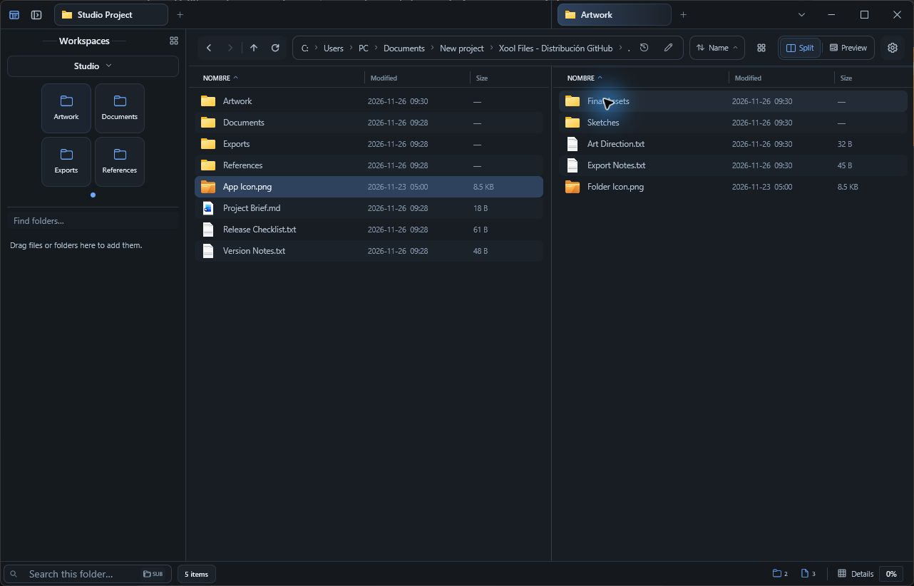
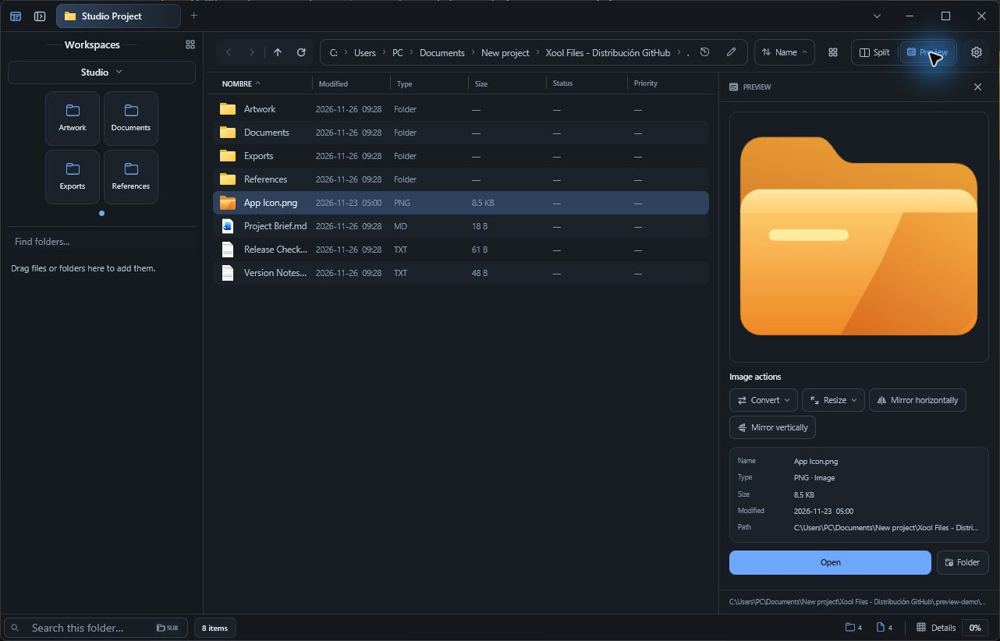

  

<h1 align="center">Xool Files</h1>

  A native Windows file manager with tabs, split panes, and workspaces. 
  Keep project folders side by side, pin frequently used files, and preview media while you browse.

  <strong><a href="https://github.com/VyxenApps/Xool-Files/releases/latest">Download for Windows</a></strong>

## Features

- **Tabs and split panes.** Browse several folders in one window and compare two locations side by side.
- **Workspaces.** Pin folders, files, and web links, and organize related shortcuts into collapsible groups.
- **Views and search.** Switch between icons, list, tree, and details. Search the current folder, include subfolders, or use indexed search across your PC.
- **File previews.** Preview images, video, audio, and text without leaving the file list.
- **Image tools.** Convert to PNG, WebP, or JPG, resize with the aspect ratio locked, or mirror an image horizontally or vertically.
- **Personalization.** Choose a theme and accent color, configure keyboard shortcuts, and switch between English and Spanish.

## Getting started

1. Open the [latest release](https://github.com/VyxenApps/Xool-Files/releases/latest).
2. Under **Assets**, download the Xool Files ZIP and extract it.
3. Run **Xool Files.exe**. Use the gear button in the toolbar to open **Settings**.

## Source and build instructions

See the [development guide](docs/DEVELOPMENT.md) for requirements and build commands, or the [user guide](docs/USER_GUIDE.md) for navigation, search, and settings.

## License

Xool Files is developed by [Vyxen Apps](https://github.com/VyxenApps). The original Xool Files code is licensed under the [GNU General Public License, version 3 only](LICENSE) (`GPL-3.0-only`). See the [third-party notices](THIRD_PARTY_NOTICES.md) for dependency licenses.
